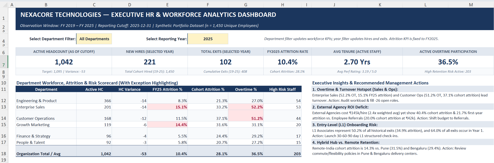
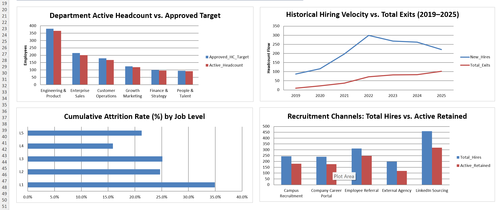
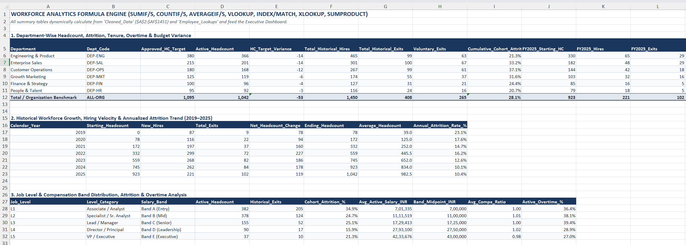
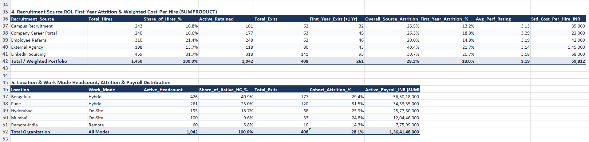
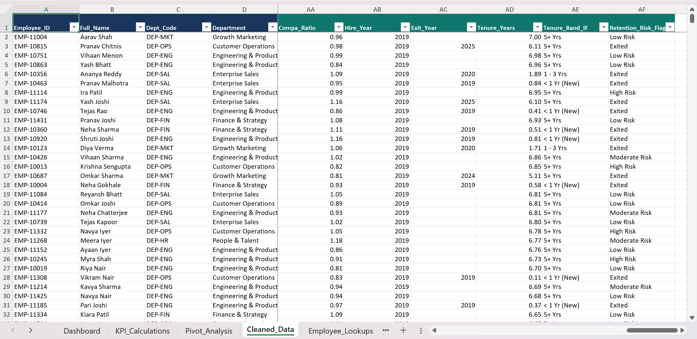
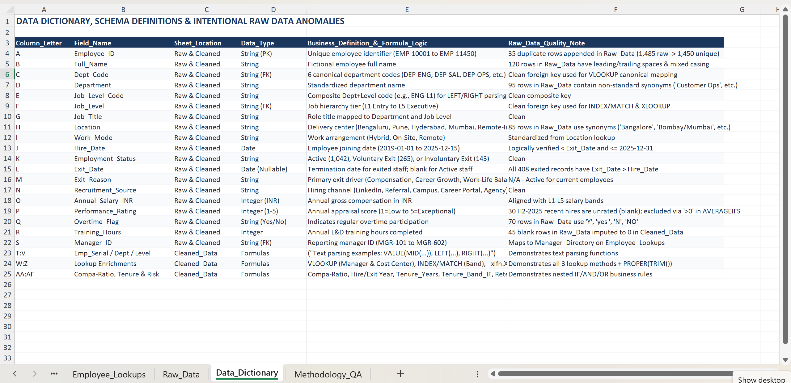

# HR & Workforce Analytics Dashboard — Excel Business Analysis

## Business context
This project examines workforce capacity, employee retention, recruitment-source outcomes, overtime, and compensation patterns for a fictional mid-sized technology company, **NexaCore Technologies Pvt. Ltd.** It demonstrates how a business analyst can translate workforce data into management questions, define consistent KPIs, identify areas for investigation, and propose evidence-led actions.

**Analysis period:** 1 January 2019–31 December 2025  
**Reporting cutoff:** 31 December 2025  
**Dataset:** 1,485 synthetic employee records  
**Tools:** Microsoft Excel, formulas, lookup tables, data validation, conditional formatting, and dashboard charts

> **Data notice:** All company details and employee records are synthetic and created for portfolio demonstration. They do not describe a real organisation or real employees.

## Business objectives and stakeholder decisions
The analysis is designed to support HR and business leadership in:
- Monitoring active headcount against approved department targets.
- Understanding FY2025 attrition and longer-term cohort attrition using clearly defined denominators.
- Comparing recruitment-source hiring volume, cost, and retention outcomes.
- Examining tenure, overtime, performance ratings, salary-band positioning, and retention-risk flags.
- Identifying workforce segments that warrant further investigation and prioritising potential interventions.

## Data and analytical approach
- **Raw dataset:** 1,485 rows, including 35 intentional duplicate records; reference sheets provide department budgets, job-level salary bands, manager records, and anomaly guidance.
- **Cleaned analytical cohort:** 1,450 unique employee IDs, with documented cleaning and enrichment logic.
- **Workbook:** Eight sheets covering the dashboard, KPI calculations, pivot-style analysis, cleaned data, lookups, raw data, data dictionary, and methodology/QA.

The workbook uses formula-driven summary matrices and dropdown filters. It does not contain embedded native PivotTables or slicers.

## Executive KPI summary

| KPI | Result | Definition |
|---|---:|---|
| Active headcount | 1,042 | Employees active at the reporting cutoff |
| Approved headcount target | 1,095 | Sum of department targets |
| Headcount variance | -53 | Active headcount minus approved target |
| FY2025 hires | 221 | Employees with hire year 2025 |
| FY2025 exits | 102 | Employees with exit year 2025 |
| FY2025 attrition rate | 10.38% | FY2025 exits ÷ average starting and ending headcount (102 ÷ 982.5) |
| Historical cohort attrition | 28.14% | Historical exits ÷ unique employees hired during 2019–2025 (408 ÷ 1,450) |
| Average active tenure | 2.70 years | Mean tenure for active employees at the cutoff |
| Active overtime participation | 36.47% | Active employees flagged for overtime ÷ active headcount (380 ÷ 1,042) |
| Average performance rating | 3.19 / 5 | Average among 1,420 employees with a completed rating |
| High-retention-risk active employees | 203 | Active employees meeting the documented overtime/performance/compa-ratio rule |
| Weighted cost per hire | ₹59,812 | Weighted average using recruitment-source hires and standard cost per hire |

## Selected findings and business implications

1. **Recruitment-source outcomes:** External agencies have the highest standard cost per hire (₹145,000) and the highest cohort attrition (40.4%). Employee referrals cost ₹42,000 per hire and have 20.0% cohort attrition. This is an association in synthetic data, not proof that recruitment source causes attrition. HR could review source quality and post-hire outcomes before changing sourcing allocation.
2. **Overtime and turnover patterns:** Enterprise Sales has 52.2% active overtime participation and 15.1% FY2025 attrition. Customer Operations has 51.2% overtime participation and 37.1% cohort attrition. These patterns warrant workload, manager, and exit-interview investigation; they do not establish causation.
3. **Early-tenure retention:** L1 employees have 34.9% cohort attrition (205 exits among 587 L1 hires), and 261 of 408 total exits occurred within the first year. A structured 30-60-90 day onboarding intervention could be tested and evaluated.
4. **Workforce planning:** Active headcount is 53 below the aggregate approved target. Department-level gaps should be reviewed alongside hiring plans, role criticality, and budget availability.

## Recommended management actions
- Review recruitment-source performance using both cost and retention outcomes, with cohort size and role mix considered.
- Investigate sustained overtime in Enterprise Sales and Customer Operations using workload allocation, staffing, and exit feedback.
- Pilot structured early-tenure onboarding for selected L1 roles and track retention at defined checkpoints.
- Review department-level headcount variance against approved budgets and operational demand.
- Treat the 203 high-retention-risk flag as a prioritisation aid for review, not a definitive prediction about individual employees.

These are proposed actions for the fictional scenario. They have not been implemented or measured in a real organisation.

## Workbook and dataset
- [Open the Excel dashboard workbook](Excel%20Workbook/HR_Workforce_Analytics_Dashboard.xlsx)
- [Open the raw synthetic workforce dataset](Dataset/HR_Workforce_Analytics_Dataset.xlsx)

### Workbook sheets
`Dashboard`, `KPI_Calculations`, `Pivot_Analysis`, `Cleaned_Data`, `Employee_Lookups`, `Raw_Data`, `Data_Dictionary`, and `Methodology_QA`.

## Dashboard and supporting evidence

### Executive dashboard


### Workforce dashboard detail


### Department workforce analysis


### Recruitment and retention analysis


### Data preparation and QA




## KPI interpretation and limitations
- FY2025 attrition uses FY2025 exits divided by average FY2025 starting and ending headcount.
- Historical cohort attrition uses cumulative exits divided by the 1,450 unique employees hired during 2019–2025. These two measures have different denominators and should not be compared as though they were equivalent.
- The retention-risk flag is a rule-based indicator using the documented overtime, performance, and compa-ratio conditions. It is not a validated predictive model.
- The workbook uses formula-driven summary matrices and dropdown filters; these are not embedded PivotTables or slicers.
- Power Query M and VBA examples in `Methodology_QA` are optional learning references, not an embedded refresh pipeline or enabled macro.

## Repository structure
```text
hr-workforce-analytics-dashboard-Excel/
├── Dataset/
│   └── HR_Workforce_Analytics_Dataset.xlsx
├── Excel Workbook/
│   └── HR_Workforce_Analytics_Dashboard.xlsx
├── Screenshots/
│   ├── 01-hr-executive-dashboard-1.png
│   ├── 02-hr-executive-dashboard-2.png
│   ├── 03-department-workforce-analysis.png
│   ├── 04-recruitment-retention-analysis.png
│   ├── 05-cleaned-employee-data.png
│   └── 06-data-dictionary-qa.png
└── README.md
```

## Tools and skills demonstrated
Business problem framing, workforce KPI design, HR and recruitment analytics, attrition and retention analysis, headcount planning, data cleaning, Excel formulas, lookup enrichment, dashboard reporting, data-quality documentation, and evidence-based business recommendations.

## Author
**Sarthak Jaykar**  
[GitHub](https://github.com/sarthak-jaykar) · [LinkedIn](https://www.linkedin.com/in/sarthak-jaykar/)
